# SSH Access to an Internal Docker Container Through a Public Relay

## Objective

I need to use an OpenSSH client on laptop **LapC** to connect to an SSH service inside a Docker container on server **SrvA**. The container’s `sshd` listens on TCP port `5395` inside the container.

I want the connection to be stable and usable as a normal SSH session through a saved SSH configuration alias, without exposing port `5395` publicly on the relay server.

## Environment

| Host | Location and connectivity |
|---|---|
| **SrvA** | Internal organization server. It has no access outside the organization’s internal network. It hosts a Docker container whose custom `sshd` listens on TCP `5395` inside the container; access to the container must go through an SSH daemon on SrvA, forwarding to `127.0.0.1:5395` on SrvA. |
| **DskA** | Internal desktop powered on 24/7, with full administrative control of SrvA. It can access SrvA over the internal network and may configure the existing `sshd` on TCP `22` or run a separate `sshd` on TCP `2022`. It does not need direct access to the container. It can reach SrvB only through HTTPS; raw SSH or arbitrary TCP connections to SrvB are not permitted. WebSockets work through the organization's network. |
| **SrvB** | Internet-accessible server currently accessed by public IPv4 address only. It has a TLS certificate for that address that DskA can validate and trust. Inbound ports `22`, `80`, and `443` are reachable from the internet; ports `80` and `443` are unused and available for relay software. |
| **LapC** | Laptop in a private network. It can reach SrvB's SSH port `22`. The preferred client is OpenSSH, ideally without additional local helper software. No direct route to SrvA or DskA should be assumed. |

## Required Connection Path

The desired SSH traffic path is:

```mermaid
flowchart LR
    LapC["LapC<br/>OpenSSH client"]
    SrvB["SrvB<br/>Public relay<br/>IPv4 only; ports 80/443 available"]
    SrvBLoopback["SrvB loopback<br/>127.0.0.1:22022"]

    subgraph Internal["Organization's internal network"]
        DskA["DskA<br/>Internal bridge"]
        subgraph SrvA["SrvA<br/>Internal server"]
            SrvAHost["SrvA host<br/>sshd: TCP 22 or 2022"]
            SrvALoopback["SrvA host loopback<br/>127.0.0.1:5395"]
            Container["Docker container<br/>sshd: TCP 5395 internally"]
        end
    end

    LapC -->|"SSH to SrvB: TCP 22"| SrvB
    SrvB -->|"OpenSSH TCP forwarding"| SrvBLoopback
    SrvBLoopback -->|"Reverse tunnel stream"| DskA
    DskA -->|"Internal SSH: TCP 22 or 2022"| SrvAHost
    SrvAHost -->|"SSH TCP forwarding"| SrvALoopback
    SrvALoopback -->|"Host-to-container route"| Container
    DskA -.->|"Initiates WSS over HTTPS: TCP 443"| SrvB
```



Solid arrows show the logical SSH traffic path; the session carries traffic in both directions. The dashed arrow shows that DskA initiates a secure WebSocket (WSS) connection to SrvB over HTTPS. This reverse tunnel makes SrvA's SSH daemon reachable through a listener on SrvB's loopback interface; it does not expose that listener publicly.

For example, Docker can publish the container port as `127.0.0.1:5395:5395` on SrvA. The container's `sshd` must also listen on an interface reachable by that forwarding; the container's own `127.0.0.1` is not the same as SrvA's loopback address.

LapC does not need direct network access to SrvA or DskA. DskA provides the bridge because it can reach SrvA and establish an outbound HTTPS connection to SrvB.

## Constraints

1. SrvA cannot initiate a connection to the public internet.
2. LapC must ultimately communicate with the container’s custom SSH service on port `5395`.
3. SrvB must not expose TCP `5395` directly to the internet.
4. DskA’s connection to SrvB must use genuine HTTPS, not raw SSH or another unrestricted TCP protocol over port `443`.
5. LapC can use OpenSSH to connect to SrvB on TCP `22`.
6. Manual startup or restart of the relay/tunnel is sufficient. Automatic startup, automatic reconnection, and preservation of an existing SSH session after an interruption are not required.
7. Administrative access to DskA, SrvA, and SrvB is available for configuring SSH and running relay or proxy software, if required.
8. SrvA's `sshd` must permit the forwarding needed to reach the container's SSH service.
9. `127.0.0.1:5395` on SrvA must route to the container's SSH service on TCP `5395`.
10. The reverse listener on SrvB's `127.0.0.1:22022` must not be exposed publicly.

## Definition of Success

After manually starting the required relay/tunnel components, the following command on LapC must open a normal SSH session authenticated by the container's SSH service:

```bash
ssh SrvA-at5395-viaSrvB
```

The saved SSH configuration may use a jump host, proxy, or tunnel internally.

Successful connections must satisfy all of the following:

- Traffic reaches the container’s SSH service on TCP port `5395`.
- SrvA requires no outbound internet access.
- DskA uses only HTTPS to communicate with SrvB.
- Port `5395` remains inaccessible as a public port on SrvB.
- SSH authentication succeeds directly against the container’s SSH service.

## Solution

Use an authenticated reverse TCP tunnel over WSS for DskA's connection to SrvB, and OpenSSH jump hosts for LapC's connection to the container. The relay listener on SrvB is restricted to loopback; the container remains reachable only through SrvA's SSH daemon.

> **Policy check:** This design carries the SSH connection through an authenticated, destination-restricted WSS tunnel; it is not intended as a general-purpose TCP proxy. WebSocket availability alone does not confirm that this use is permitted by the organization's HTTPS policy. Confirm that SSH-only forwarding through WSS is allowed; otherwise, this design does not satisfy Constraint 4 and must be replaced with an approved application-layer relay.

### SrvA

The examples use the existing Docker image and a separate host-side SSH daemon on `2022`, leaving the existing SSH service on `22` unchanged. SrvA may be Ubuntu or macOS with Docker Desktop; the container itself must contain a Linux OpenSSH server.

#### 1. Prepare the existing image and SSH credentials

- The image must already include `/usr/sbin/sshd`, `ssh-keygen`, and a usable non-root account. The examples call that account `container-user`; replace it with the actual account throughout.
- If those components are missing, prepare the image using an approved internal package repository or build system. Do not assume SrvA can download packages from the internet.
- Generate the LapC keys described below and transfer **only their public keys** through an approved administrative channel. SrvA needs `arena_srva.pub` and `arena_container.pub`; private keys remain on LapC.
- Docker commands must target SrvA's Docker Engine or its local Docker Desktop, not a different machine's Docker context.

#### 2. Publish the container port on host loopback

Add these options to the container's original `docker run` command, preserving its image, entrypoint, application command, environment, networks, and data mounts:

```text
--publish 127.0.0.1:5395:5395/tcp
--mount type=volume,source=arena_container_hostkeys,target=/etc/ssh/arena_hostkeys
```

For an image whose normal entrypoint already keeps the container running, a minimal example is:

```bash
docker run -d --name arena-container \
  --publish 127.0.0.1:5395:5395/tcp \
  --mount type=volume,source=arena_container_hostkeys,target=/etc/ssh/arena_hostkeys \
  YOUR_EXISTING_IMAGE
```

Alternatively, merge this into the **existing service** in its Docker Compose configuration:

```yaml
services:
  existing-service:
    ports:
      - "127.0.0.1:5395:5395/tcp"
    volumes:
      - arena_container_hostkeys:/etc/ssh/arena_hostkeys

volumes:
  arena_container_hostkeys:
```

Preserve existing Compose ports and volumes when merging. Apply the change with `docker compose up -d existing-service`.

The mapping means:

```text
127.0.0.1 on SrvA : 5395  ->  container network interface : 5395
```

`EXPOSE 5395` alone does not publish a port. Docker cannot add this publishing rule to an already-running container in place: recreate it using the original settings, after preserving any data stored only in its writable layer. Do not delete the existing container or its volumes blindly.

Use Docker Engine 28 or newer and ordinary bridge/NAT networking without enabled direct routing. Docker documents that older versions can expose localhost-published ports to peers on the same L2 network. Local processes on SrvA and peers on the container's Docker network may still reach the service; loopback publishing is not isolation from those local peers.

#### 3. Configure the SSH daemon inside the container

On SrvA, save the following as `sshd_config_5395`:

```text
Port 5395
ListenAddress 0.0.0.0
HostKey /etc/ssh/arena_hostkeys/ssh_host_ed25519_key
PidFile /run/sshd_arena_5395.pid
PubkeyAuthentication yes
AuthorizedKeysFile /etc/ssh/arena_authorized_keys/%u
PasswordAuthentication no
KbdInteractiveAuthentication no
PermitRootLogin no
UsePAM yes
AllowUsers container-user
```

`ListenAddress 0.0.0.0` is **inside the container**. It lets Docker deliver traffic to the container's network interface. Listening only on the container's `127.0.0.1` would not accept this bridge-network forwarding.

This sample uses PAM-enabled OpenSSH, as in Ubuntu-based images. If the existing image uses a different account/PAM setup, retain its known-working settings rather than assuming `UsePAM yes` applies. The selected account must not be expired or denied by that policy.

Prepare the configuration and key inside the container:

```bash
CONTAINER="arena-container" # Use the actual container name.

docker exec --user 0 "$CONTAINER" id container-user
docker cp ./sshd_config_5395 "$CONTAINER:/etc/ssh/sshd_config_5395"
docker cp ./arena_container.pub "$CONTAINER:/tmp/arena_container.pub"

docker exec --user 0 "$CONTAINER" sh -c '
  set -eu
  mkdir -p /run/sshd /etc/ssh/arena_hostkeys /etc/ssh/arena_authorized_keys
  chmod 755 /run/sshd /etc/ssh/arena_authorized_keys
  chmod 700 /etc/ssh/arena_hostkeys
  if [ ! -f /etc/ssh/arena_hostkeys/ssh_host_ed25519_key ]; then
    ssh-keygen -t ed25519 -N "" -f /etc/ssh/arena_hostkeys/ssh_host_ed25519_key
  fi
  cat /tmp/arena_container.pub >> /etc/ssh/arena_authorized_keys/container-user
  chown root:root /etc/ssh/sshd_config_5395 \
    /etc/ssh/arena_authorized_keys /etc/ssh/arena_authorized_keys/container-user \
    /etc/ssh/arena_hostkeys /etc/ssh/arena_hostkeys/ssh_host_ed25519_key
  chmod 644 /etc/ssh/sshd_config_5395 /etc/ssh/arena_authorized_keys/container-user
  chmod 600 /etc/ssh/arena_hostkeys/ssh_host_ed25519_key
  rm /tmp/arena_container.pub
'

docker exec --user 0 "$CONTAINER" \
  /usr/sbin/sshd -t -f /etc/ssh/sshd_config_5395
```

If validation fails, fix the reported configuration, account, or host-key error before proceeding. Manually start the daemon in a terminal:

```bash
docker exec --user 0 -it "$CONTAINER" \
  /usr/sbin/sshd -D -e -f /etc/ssh/sshd_config_5395
```

Keep that terminal open; `-D -e` keeps the daemon in the foreground and sends errors to the terminal. If the image already starts a daemon on `5395`, configure that service instead of starting a second daemon on the same port.

The named volume preserves the SSH host key across container recreation. The copied configuration and authorized key must be reapplied after recreation, or included in a deliberately prepared image/persistent configuration.

From another terminal on SrvA, check:

```bash
docker port "$CONTAINER" 5395/tcp
ssh-keyscan -T 5 -p 5395 127.0.0.1
docker exec --user 0 "$CONTAINER" \
  ssh-keygen -lf /etc/ssh/arena_hostkeys/ssh_host_ed25519_key.pub
```

The port command must show `127.0.0.1:5395`, not `0.0.0.0:5395`. `ssh-keyscan` should receive the container's host key; it is a connectivity check, not a substitute for verifying the fingerprint.

#### 4. Configure the host-side SSH forwarding daemon

Choose an existing non-root account on SrvA and authorize LapC's `arena_srva.pub` key for it. For standard Ubuntu/macOS home directories:

```bash
SRVA_USER="YOUR_EXISTING_SRVA_USER"
SRVA_GROUP="$(id -gn "$SRVA_USER")"
SRVA_HOME="/home/$SRVA_USER" # On macOS use /Users/$SRVA_USER.

sudo mkdir -p "$SRVA_HOME/.ssh"
sudo tee -a "$SRVA_HOME/.ssh/authorized_keys" < ./arena_srva.pub
sudo chown "$SRVA_USER:$SRVA_GROUP" \
  "$SRVA_HOME/.ssh" "$SRVA_HOME/.ssh/authorized_keys"
sudo chmod 700 "$SRVA_HOME/.ssh"
sudo chmod 600 "$SRVA_HOME/.ssh/authorized_keys"
sudo ssh-keygen -A
```

Create `/etc/ssh/sshd_config_arena_2022`, replacing the address and account placeholders:

```text
Port 2022
ListenAddress <SrvA-internal-IP>
HostKey /etc/ssh/ssh_host_ed25519_key
PidFile /var/run/sshd_arena_2022.pid
PubkeyAuthentication yes
AuthorizedKeysFile .ssh/authorized_keys
AuthenticationMethods publickey
PasswordAuthentication no
KbdInteractiveAuthentication no
PermitRootLogin no
UsePAM yes
AllowUsers <SrvA-user>
AllowTcpForwarding local
PermitOpen 127.0.0.1:5395
PermitListen none
AllowStreamLocalForwarding no
AllowAgentForwarding no
X11Forwarding no
PermitTTY no
MaxSessions 0
```

`MaxSessions 0` disables shell/session channels on this dedicated daemon while retaining TCP forwarding. It does not restrict the final interactive session inside the container.

On Ubuntu, ensure `/run/sshd` exists with root ownership and mode `755`. Make the custom configuration root-owned and non-writable by other users, then validate and start the separate daemon manually:

```bash
sudo chown root /etc/ssh/sshd_config_arena_2022
sudo chmod 644 /etc/ssh/sshd_config_arena_2022
sudo /usr/sbin/sshd -t -f /etc/ssh/sshd_config_arena_2022 &&
  sudo /usr/sbin/sshd -D -e -f /etc/ssh/sshd_config_arena_2022
```

Permit DskA's internal address to reach SrvA on `2022` through the host and network firewalls. Full control of SrvA does not override a separate organization's network firewall. If only port `22` is allowed, use the existing host daemon instead, configure a dedicated account with the forwarding restrictions above, and select port `22` in DskA's tunnel command. Validate any existing-daemon changes before an administrator-approved reload; retain the current administrative SSH session.

### DskA

Use [Chisel](https://github.com/jpillora/chisel) as the concrete reverse-tunnel implementation. Install an approved release matching DskA's OS/architecture; use the same release on SrvB. Chisel accepts an `https://` server URL and performs a WebSocket upgrade over TLS. Do not use plain `http://` or disable TLS verification.

Start SrvB's server first, following the next subsection. Obtain its Chisel SSH fingerprint and the tunnel password through a trusted administrative channel. The Chisel fingerprint is separate from the HTTPS certificate and the OpenSSH host keys.

#### macOS

Put the approved `chisel` executable on your `PATH`, then use:

```bash
SRVB_IP="YOUR_SRVB_PUBLIC_IPV4"
SRVA_IP="YOUR_SRVA_INTERNAL_IP"
SRVA_SSH_PORT="2022" # Use 22 if forwarding through the existing host daemon.
CHISEL_FINGERPRINT="YOUR_VERIFIED_CHISEL_FINGERPRINT"

nc -vz "$SRVA_IP" "$SRVA_SSH_PORT" &&
  curl --show-error --verbose --output /dev/null "https://${SRVB_IP}:443/"
```

Only after both checks succeed, start the client in the same terminal:

```bash
read -r -s -p "Tunnel password: " TUNNEL_PASSWORD
printf '\n'
export AUTH="arena-tunnel:${TUNNEL_PASSWORD}"
unset TUNNEL_PASSWORD
chisel client \
  --fingerprint "$CHISEL_FINGERPRINT" \
  "https://${SRVB_IP}:443" \
  "R:127.0.0.1:22022:${SRVA_IP}:${SRVA_SSH_PORT}"
unset AUTH
```

The password is entered without echoing and is not written into the command history. Keep the client running in that terminal.

#### Windows (PowerShell)

Use the approved `chisel.exe` binary:

```powershell
$SrvBIP = "YOUR_SRVB_PUBLIC_IPV4"
$SrvAIP = "YOUR_SRVA_INTERNAL_IP"
$SrvASshPort = 2022 # Use 22 for the existing host daemon.
$ChiselFingerprint = "YOUR_VERIFIED_CHISEL_FINGERPRINT"

if (-not (Test-NetConnection -ComputerName $SrvAIP -Port $SrvASshPort -InformationLevel Quiet)) {
    throw "DskA cannot reach SrvA's selected SSH port"
}
curl.exe --show-error --verbose --output NUL "https://${SrvBIP}:443/"
if ($LASTEXITCODE -ne 0) {
    throw "HTTPS verification failed with curl exit code $LASTEXITCODE"
}

$TunnelPassword = Read-Host "Tunnel password" -AsSecureString
$env:AUTH = "arena-tunnel:" + [System.Net.NetworkCredential]::new("", $TunnelPassword).Password
try {
    & .\chisel.exe client `
        --fingerprint $ChiselFingerprint `
        "https://${SrvBIP}:443" `
        "R:127.0.0.1:22022:${SrvAIP}:${SrvASshPort}"
    if ($LASTEXITCODE -ne 0) {
        throw "Chisel exited with code $LASTEXITCODE"
    }
}
finally {
    Remove-Item Env:AUTH
    $TunnelPassword.Dispose()
}
```

Proceed only when the internal TCP check succeeds and curl verifies TLS. A normal HTTP error response from Chisel's non-WebSocket endpoint can be expected; a TLS validation error is not acceptable. If a proxy or policy blocks the connection, obtain the approved configuration rather than bypassing the policy.

The remote specification means:

```text
R:127.0.0.1:22022:<SrvA-internal-IP>:2022
  |________________| |_____________________|
    SrvB listener       destination opened by DskA
```

DskA connects to SrvA internally. SrvB uses the established WSS tunnel to carry those connections; it does not initiate an inbound connection to DskA. Chisel can retry automatically, but that is not required for success and does not restore a dropped interactive SSH session.

### SrvB

These commands assume Ubuntu. Install the same approved Chisel release as DskA at `/usr/local/bin/chisel`. Use the existing certificate valid for SrvB's IPv4 address; no DNS name or automatic domain certificate issuance is needed.

#### 1. Prepare the authenticated TLS relay

Create a root-only configuration directory:

```bash
sudo install -d -m 700 /etc/chisel-arena
```

Place the existing certificate chain at `/etc/chisel-arena/fullchain.pem` and its matching private key at `/etc/chisel-arena/privkey.pem`. Keep the private key readable only by the server administrator.

Create `/etc/chisel-arena/users.json`, substituting a long random password generated and stored using your approved credential-management process. A random hexadecimal or base64url password avoids JSON quoting problems; otherwise, correctly escape the password as JSON:

```json
{
  "arena-tunnel:REPLACE_WITH_A_LONG_RANDOM_PASSWORD": [
    "^R:127\\.0\\.0\\.1:22022$"
  ]
}
```

The anchored expression permits only the reverse listener `127.0.0.1:22022`; it does not authorize other reverse listeners or SOCKS access. It restricts the **server-side listener**, not the destination that the DskA administrator selects. Keep DskA's client configured for the approved SrvA SSH endpoint.

Generate Chisel's persistent SSH key once, not on every startup:

```bash
sudo chisel server --keygen /etc/chisel-arena/chisel.key
sudo chmod 600 /etc/chisel-arena/users.json \
  /etc/chisel-arena/privkey.pem /etc/chisel-arena/chisel.key
```

Start the relay manually in a terminal:

```bash
sudo chisel server \
  --host 0.0.0.0 \
  --port 443 \
  --reverse \
  --authfile /etc/chisel-arena/users.json \
  --keyfile /etc/chisel-arena/chisel.key \
  --tls-cert /etc/chisel-arena/fullchain.pem \
  --tls-key /etc/chisel-arena/privkey.pem
```

Read the server's Chisel fingerprint from its startup log and provide it to DskA through a trusted administrative channel. Keep port `443` available for this service and leave TLS verification enabled on DskA.

#### 2. Configure the OpenSSH jump account

Create a dedicated account if it does not already exist, and install LapC's `arena_srvb.pub` public key:

```bash
sudo adduser --disabled-password --gecos "" srvb-relay
sudo install -d -m 700 -o srvb-relay -g srvb-relay /home/srvb-relay/.ssh
sudo tee -a /home/srvb-relay/.ssh/authorized_keys < ./arena_srvb.pub
sudo chown srvb-relay:srvb-relay /home/srvb-relay/.ssh/authorized_keys
sudo chmod 600 /home/srvb-relay/.ssh/authorized_keys
```

Add this account-specific block to the effective OpenSSH server configuration, without replacing unrelated global settings or other accounts' rules:

```text
Match User srvb-relay
    PubkeyAuthentication yes
    AuthenticationMethods publickey
    PasswordAuthentication no
    KbdInteractiveAuthentication no
    AllowTcpForwarding local
    PermitOpen 127.0.0.1:22022
    PermitListen none
    AllowStreamLocalForwarding no
    AllowAgentForwarding no
    X11Forwarding no
    PermitTTY no
    MaxSessions 0
Match all
```

Check syntax and the effective forwarding policy, replacing the connection address with LapC's actual source address as seen by SrvB:

```bash
sudo /usr/sbin/sshd -t
sudo /usr/sbin/sshd -T \
  -C user=srvb-relay,host=lapc,addr=YOUR_LAPC_SOURCE_IP
```

Do not reload if validation fails. Confirm the effective settings include local TCP forwarding and `PermitOpen 127.0.0.1:22022`, with no overriding `DisableForwarding yes` or authorized-key restrictions denying the necessary channel. Keep an existing administrator session open while changing SSH configuration. Only after those checks succeed, reload:

```bash
sudo systemctl reload ssh
```

#### 3. Check the reverse listener

After DskA connects, run:

```bash
sudo ss -ltnp 'sport = :22022'
ssh-keyscan -T 5 -p 22022 127.0.0.1
```

The listener must be `127.0.0.1:22022`, not a wildcard/public address. The returned SSH host key must be SrvA's host key, not the container's key. Confirm access to SrvB's public port `22022` fails from another host.

Only SrvB's ports `22` and `443` are used publicly. Do not open `22022` or `5395` in its firewall.

### LapC

#### 1. Prepare separate SSH keys

Using OpenSSH on LapC, generate keys for the SrvB jump account, SrvA host account, and container account:

```bash
ssh-keygen -t ed25519 -f ~/.ssh/arena_srvb -C arena-srvb
ssh-keygen -t ed25519 -f ~/.ssh/arena_srva -C arena-srva
ssh-keygen -t ed25519 -f ~/.ssh/arena_container -C arena-container
```

Use passphrases and your normal SSH agent if desired. If a named key already exists, do not overwrite it. On Windows, run the same commands from an OpenSSH-enabled terminal using paths under `$HOME/.ssh`.

Transfer the `.pub` files through approved administrative channels to the corresponding hosts. Do not copy these private keys to DskA, SrvA, SrvB, or the container.

#### 2. Save the OpenSSH aliases

Add these entries to `~/.ssh/config` (`$HOME/.ssh/config` on Windows), replacing the angle-bracketed values:

```sshconfig
Host SrvB-relay
    HostName <SrvB-public-IPv4>
    Port 22
    User srvb-relay
    IdentityFile ~/.ssh/arena_srvb
    IdentitiesOnly yes

Host SrvA-viaSrvB
    HostName 127.0.0.1
    Port 22022
    User <SrvA-user>
    IdentityFile ~/.ssh/arena_srva
    IdentitiesOnly yes
    HostKeyAlias arena-SrvA-host
    ProxyJump SrvB-relay

Host SrvA-at5395-viaSrvB
    HostName 127.0.0.1
    Port 5395
    User container-user
    IdentityFile ~/.ssh/arena_container
    IdentitiesOnly yes
    HostKeyAlias arena-SrvA-container
    ProxyJump SrvA-viaSrvB
```

`127.0.0.1:22022` is resolved at the **SrvB jump host**, while `127.0.0.1:5395` is reached from the **SrvA jump host**. Neither refers to a local listener on LapC. The separate host-key aliases distinguish the SrvA host from its container.

Verify all three SSH host fingerprints through a trusted administrative channel before accepting new host keys. SrvA/SrvB administrators can run `ssh-keygen -lf /etc/ssh/ssh_host_ed25519_key.pub`; the container fingerprint command is shown in the SrvA subsection. Do not disable host-key checking.

#### 3. Start and verify the connection

Startup order:

1. On SrvA, ensure the container daemon and selected host daemon are running.
2. On SrvB, start the Chisel TLS server.
3. On DskA, start its authenticated Chisel client and verify SrvB's loopback listener.
4. On LapC, connect with:

```bash
ssh SrvA-at5395-viaSrvB
```

Inside the session, `whoami` must identify the container account. Compare `hostname` and the session's environment with `docker exec` on SrvA to confirm that the shell is in the intended container, not merely on the SrvA host.

For connection diagnostics, use:

```bash
ssh -vvv SrvA-at5395-viaSrvB
```

Keep diagnostic logs private and do not share credentials or unrelated host information. A failure must be fixed at the stage reported: SrvB authentication/forwarding, WSS relay, SrvA authentication/forwarding, host-loopback mapping, or final container authentication.

No Chisel binary or other tunnel helper is required on LapC. After an interruption, manually restart the affected components and run the same SSH alias again.

### References

- [Chisel usage: TLS, authentication, fingerprints, and reverse remotes](https://github.com/jpillora/chisel#usage)
- [Docker port publishing and localhost-binding limitations](https://docs.docker.com/engine/network/port-publishing/)
- [OpenSSH server configuration](https://man.openbsd.org/sshd_config)
- [OpenSSH client configuration and ProxyJump](https://man.openbsd.org/ssh_config)