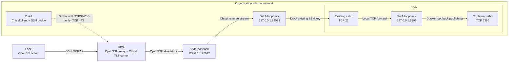

# SSH Access to an Internal Docker Container through a Public Relay

## Objective

Use OpenSSH on laptop **LapC** to log in to a container on internal server
**SrvA**. The container's custom `sshd` listens on TCP `5395`.

The connection must use SrvB as a public relay, keep public ports `22022` and
`5395` closed, and avoid exposing LapC to SrvA. LapC authenticates directly to
the container through a nested SSH connection.

## Roles

| Role | Responsibility |
|---|---|
| **AdmX** | Central key-generation and key-custody authority. Holds the complete solution-managed private/public key inventory, performs tests, rotates credentials, and securely delivers only the minimum material required by each host. |
| **DskA** | Internal administrative bridge. Uses its existing normal SSH account/key to reach SrvA and runs the outer `ssh -N` forward plus the Chisel client. |
| **SrvB** | Public relay. Terminates TLS, runs the authenticated Chisel server, and exposes only a loopback reverse listener. It knows no SrvA address or credential. |
| **SrvA** | Hosts the existing Docker image and authorizes DskA's normal SSH account. It sees only DskA at the outer SSH layer. |
| **LapC** | User SSH client. Holds only the `lapc_srvb_auth` and `lapc_container_auth` private keys. |
| **Container** | Runs the final SSH daemon and authorizes only the `lapc_container_auth.pub` matching LapC's private key. |

AdmX is a role, not necessarily a separate machine. It may be an approved
offline workstation, central vault, or dedicated administrative service.
Because AdmX holds every solution-managed private key, it can impersonate any
role for testing.

Existing SrvA/SrvB host private keys remain under their server administrators'
control unless those administrators explicitly delegate custody or rotation to
AdmX. Without SrvA `sshd` or host-root access, AdmX cannot take custody of or
rotate SrvA's existing host key.

## Environment

| Host | Role and connectivity |
|---|---|
| **SrvA** | Internal server with no public outbound access. Hosts the existing Docker image. The container SSH daemon listens on `5395`; Docker publishes it only as `127.0.0.1:5395:5395`. |
| **DskA** | Internal administrative desktop. Has normal-user SSH access to SrvA on TCP `22`. It may reach SrvB only over HTTPS/WebSocket on TCP `443`. |
| **SrvB** | Public server with a TLS certificate valid for its IPv4 address. Inbound `22`, `80`, and `443` are available; `80` is unused and `443` is used by Chisel. |
| **LapC** | Internal laptop that can route to SrvB. It has OpenSSH and uses the alias `container-via-srvb`. |

DskA does not use SSH, SCP, SFTP, plain HTTP, or raw TCP to SrvB.

## Selected connection path



The traffic has two SSH layers:

1. DskA authenticates to SrvA using its existing normal account and key.
2. LapC's original SSH connection to the container remains encrypted inside
   that outer DskA-to-SrvA SSH transport.

The container authenticates LapC directly with `lapc_container_auth`. SrvA sees
DskA's SSH identity and an encrypted forwarded stream, not LapC's SSH key or
source address.

## Key and authority model

| Credential | AdmX vault | Runtime holder |
|---|---|---|
| `lapc_srvb_auth` / `.pub` | Complete pair | LapC private; SrvB jump-account public authorization |
| `lapc_container_auth` / `.pub` | Complete pair | LapC private; container public authorization |
| DskA-to-SrvA pair | Full copy when custody is authorized | DskA private; SrvA public authorization |
| Container host pair | Complete pair | Container host-key volume |
| Chisel server identity | Private key and fingerprint | SrvB private; DskA fingerprint |
| SrvB TLS key/certificate | Protected key and certificate inventory | SrvB key/certificate; DskA certificate trust |

Every other host receives only the keys and public trust material required for
its role. DskA receives no LapC private key. SrvA receives no LapC
authentication key.

The container is configured with:

- Public-key authentication only.
- `PasswordAuthentication no`.
- `KbdInteractiveAuthentication no`.
- Exactly one `lapc_container_auth.pub` authorization.
- No alternate trust source.

This allows any client holding the matching `lapc_container_auth` private key to
authenticate. Under the chosen design, that is LapC and AdmX's master vault.

## Key delivery

AdmX securely delivers:

```text
LapC:
  lapc_srvb_auth
  lapc_srvb_auth.pub
  lapc_container_auth
  lapc_container_auth.pub

DskA:
  its own SrvA bridge key
  public trust material and required fingerprints

SrvB:
  lapc_srvb_auth.pub
  Chisel server private key
  TLS private key and certificate chain

SrvA/container:
  container host private/public pair
  lapc_container_auth.pub
```

Private keys use approved encrypted delivery channels. AdmX retains the master
inventory for verification, testing, recovery, and rotation.

## Constraints and required permission

1. SrvA cannot initiate public Internet connections.
2. LapC routes to SrvB only; it has no SrvA or DskA address.
3. DskA accesses SrvB only through HTTPS/WebSocket on TCP `443`.
4. SrvB never learns or receives an SrvA address or credential.
5. SrvB's reverse listener is loopback-only on `127.0.0.1:22022`.
6. SrvA's Docker mapping is loopback-only on `127.0.0.1:5395`.
7. SrvA requires no LapC SSH key.
8. No second SrvA `sshd` daemon is started.
9. DskA's existing normal SrvA account must already permit local TCP
   forwarding to `127.0.0.1:5395`.
10. No Docker image build or Compose conversion is required.

If the existing normal DskA account cannot forward to `127.0.0.1:5395`, the
deployment stops. A SrvA administrator must approve the required restricted
forwarding policy; the policy must not be bypassed.

## Definition of success

After the required manual components are started, this command on LapC:

```bash
ssh container-via-srvb
```

must open a shell authenticated by the container's `sshd`, with:

- `whoami` returning the configured container account.
- The container hostname matching the intended Docker container.
- LapC's `lapc_container_auth` private key authenticating to the container.
- SrvA logging DskA's normal account, not LapC.
- SrvB never receiving SrvA's address or credentials.
- No public exposure of `22022` or `5395`.

`container-via-srvb` is the primary alias. The deployment runbook also preserves
`SrvA-at5395-viaSrvB` as a compatibility alias.

## Deployment

Follow the canonical, step-by-step deployment runbook:

[DEPLOYMENT-chiselOpenSSH.md](DEPLOYMENT-chiselOpenSSH.md)

It contains the ordered operations, verification gates, exact Chisel version
and checksums, key-delivery commands, Docker startup procedure, container SSH
configuration, SrvB relay configuration, LapC aliases, manual access revocation,
and restart/rotation policy.

## Operational security

- Keep AdmX's vault private keys encrypted and access-controlled.
- Do not put private keys in repositories, shell profiles, command history, or
  chat.
- Verify all public-key and host-key fingerprints out of band.
- Keep Chisel's TLS verification and full server fingerprint enabled.
- Do not expose `22022` or `5395` publicly.
- Keep an existing SrvB administrative SSH session open while changing its
  `sshd` configuration.
- If DskA's forwarding permission changes, re-run the Step 9 permission gate
  before retrying the tunnel.

## References

- [Chisel releases, usage, TLS, authentication, and fingerprints](https://github.com/jpillora/chisel)
- [Docker port publishing and localhost binding](https://docs.docker.com/engine/network/port-publishing/)
- [OpenSSH server configuration](https://man.openbsd.org/sshd_config)
- [OpenSSH client configuration and ProxyJump](https://man.openbsd.org/ssh_config)
